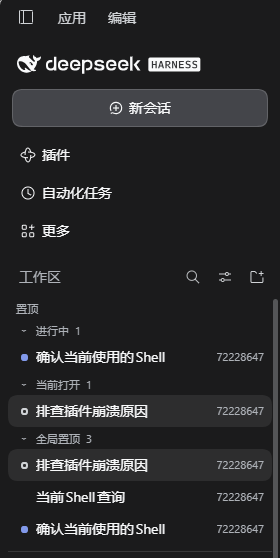

# dsh-session-focus

Keep the Sessions you must not lose track of at the top of the DSH Web sidebar: **pinned, running, finished-but-unopened, and currently open** — all in one place.

English | [中文](README.zh.md)



## What it solves

The sidebar groups Sessions by workspace, so as soon as you have a few of them the ones that are running, the ones that just finished waiting for you, and the ones you pinned all scroll out of view. This plugin inserts a **Pinned** section directly below the "Workspaces" heading and above every workspace group, collecting those Sessions at the top. Nothing else in the layout changes.

## What the section holds

In this order; empty parts are omitted:

```
Workspaces            ← shipped area heading
Pinned                ← this plugin
├─ Running 1          ← currently working
├─ Unread 1           ← finished while you had not opened it
├─ Open now 1         ← the one you are looking at
├─ Pinned workspaces  ← pinned from a workspace's "..." menu
└─ Pinned 3           ← pinned from a Session's "..." menu
```

| Group | Condition | Leading marker |
|---|---|---|
| Running | session status `running === true` | blue pulsing dot |
| Unread | session status `completionUnread === true` | green dot |
| Open now | session retained by the main view (`retainedBy.mainView > 0`) | hollow ring |

These three groups are **mutually exclusive**, ranked `running > unread > open now`. A Session you have already read, with no other state, shows **no marker at all**.

## Highlights

- **Three states collected automatically** — no manual tagging; the section follows live session state.
- **Manual pins** — "Pin globally / Unpin globally" in a Session's "..." menu, merged and deduplicated with DSH's own pin set, ordered most-recently-pinned first.
- **Pinned workspaces** — pin a whole workspace from its "..." menu; it appears in the section as an expandable folder listing its Sessions.
- **Purely additive** — the section only inserts its own block at the top. The order, contents and visibility of every group below it are untouched, and a pinned workspace's own group **stays exactly where it is**.
- **Whole-row folding** — every caption (Running, Unread, Open now, Pinned workspaces, Pinned) folds by clicking anywhere on the row, or with Tab + Enter/Space. Each group remembers its own fold state across reloads.
- **Selection matches the shipped row** — the open Session's row uses the sidebar's own selection fill (same theme token, same `aria-selected`), so the pinned copy and the original row read as one state.
- **Hover reuses the shipped menu** — a single `...` appears on hover; clicking it, right-clicking the row, or pressing <kbd>Shift</kbd>+<kbd>F10</kbd> opens the **shipped session menu** with rename, fork, archive and pin, plus entries other plugins contribute to it. Nothing is drawn at rest.
- **Follows the theme** — every color comes from `--dsw-alias-*` tokens, so light/dark and skins adapt automatically.
- **Switchable** — **Settings → General → Pinned sessions**.

## When it shows

The section renders only in the "By workspace" / "Workspace tree" views. It hides itself automatically when the sidebar is collapsed to the rail, when the list is switched to "In one list", and while search results are on screen. **While it is hidden, nothing is hidden from the list below**, and a pinned workspace's own group always stays in place.

## Install

```sh
dsh plugin add dsh-session-focus
```

In the Desktop app, install it from the Plugins page by local path.

## Self-check

```sh
npm test
```

Loads `client.js` through a stubbed dynamic-module protocol and checks the factory and export shape, the `apply()` slot registrations, section derivation (exclusive ranking, archive and subagent filtering, blank sessions, pin merge/dedup, pinned workspaces), the fold contract, the selection state, the hover control and the style rules.

## License

[MIT](LICENSE)
