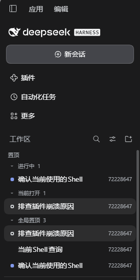

# dsh-session-focus（会话聚焦区）

把你不该跟丢的会话集中在 DSH Web 侧栏顶部：**置顶的、正在运行的、跑完还没点开的、当前打开的**，一处看完。

[English](README.md) | 中文



## 它解决什么

DSH 侧栏按工作区分组，会话一多，正在跑的、刚跑完等你查看的、已经置顶的，都会滚出视野。这个插件在**「工作区」标题下方、所有工作区分组上方**插入一个「置顶」区，把这些会话集中在顶部，其余布局一概不动。

## 置顶区里有什么

按以下顺序排列，空的部分自动省略：

```
工作区                ← 原生区域标题
置顶                  ← 本插件
├─ 进行中 1           ← 正在运行
├─ 待查看 1           ← 跑完但你没点开
├─ 当前打开 1         ← 你正在看的那个
├─ 置顶工作区         ← 从工作区「...」菜单置顶
└─ 全局置顶 3         ← 从会话「...」菜单置顶
```

| 分组 | 判据 | 行首标记 |
|---|---|---|
| 进行中 | 会话状态 `running === true` | 蓝色呼吸点 |
| 待查看 | 会话状态 `completionUnread === true` | 绿色点 |
| 当前打开 | 会话被主视图持有（`retainedBy.mainView > 0`） | 空心环 |

这三个分组**互斥**，一个会话只进其中一个，优先级为 `进行中 > 待查看 > 当前打开`。已经看过、也没有其他状态的会话，行首**不显示任何标记**。

## 主要特性

- **三类状态自动归集**：不用手动标记，跟着会话状态实时变化。
- **手动置顶**：会话「...」菜单里的「全局置顶 / 取消全局置顶」，和 DSH 原生置顶合并去重、按最近置顶排序。
- **置顶工作区**：工作区「...」菜单里可置顶整个工作区，在置顶区里以可展开文件夹的形式列出其会话。
- **纯加法，不改布局**：置顶区只在顶部插入自己那一段，下方分组的顺序、内容和可见性一概不动；置顶工作区时，它原来的分组也**保持原位**。
- **整行折叠**：每一段标题（进行中、待查看、当前打开、置顶工作区、全局置顶）点整行即可折叠，也支持 Tab + Enter/空格；折叠状态各记各的，跨刷新保留。
- **选中态与原生一致**：当前打开的会话行，使用和侧栏原生会话行完全相同的选中底色（同一主题 token、同样设置 `aria-selected`）。
- **悬停复用原生菜单**：鼠标移上去出现一枚 `...`，点它、右键、或按 <kbd>Shift</kbd>+<kbd>F10</kbd> 都会弹出**宿主原生的会话菜单**——重命名、分叉、归档、置顶都在里面，也会带上其他插件注册进该菜单的条目。默认静止状态不画任何东西。
- **跟随主题**：所有颜色取自 `--dsw-alias-*` 主题 token，明暗主题与皮肤自动适配。
- **可开关**：**设置 → 通用 → 置顶会话区**。

## 显示条件

置顶区只在「按工作区分组 / 工作区树」视图下显示。以下情况自动隐藏：侧栏收起成图标栏、切换成「一张扁平列表」、列表正在显示搜索结果。**它隐藏时不会隐藏下方任何东西**；置顶工作区的原分组也始终保持在原位。

## 安装

```sh
dsh plugin add dsh-session-focus
```

桌面版可在「插件」页里按本地路径安装。

## 自检

```sh
npm test
```

用桩化的动态模块协议加载 `client.js`，校验工厂与导出形状、`apply()` 的槽位注册、分区推导（互斥优先级、归档与 subagent 过滤、空会话、置顶合并去重、置顶工作区）、折叠契约、选中态、悬停控件与样式规则。

## 许可

[MIT](LICENSE)
